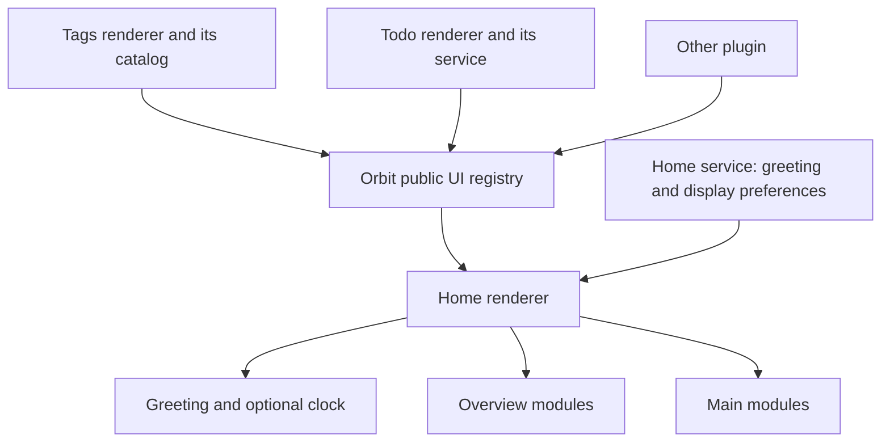

# Home architecture

A personal homepage needs to keep its layout and preferences stable while installed plugins change. Orbit Home owns that experience; providers supply independent modules. Home continues to work without Todo, Tags or any future provider.

## Ownership

| Owner | Responsibility |
| --- | --- |
| Orbit UI SDK | Validate and register immutable descriptors; expose snapshots and registry notifications |
| Home renderer | Native Home adapter; base greeting and time; overview/main layout; headings; module lifecycle and local failure UI |
| Home service | Local `home.json`; validated partial updates; serialized atomic persistence; revisioned broadcasts |
| Provider | Module body; data queries and subscriptions; domain actions; scoped styles; resource cleanup |

Home does not import business packages, query peer services, read peer stores or inspect Codex account data. Provider callbacks open the provider's existing editor or dashboard. The registry composes renderer UI within one isolated world; it is not a cross-plugin data bus or security sandbox.

## Registration and lifecycle

The descriptor contains stable `id`, human `title`, optional `slot`, `order`, `defaultVisible`, and a synchronous `mount(container)` returning cleanup. See [the exact contract and example](plugin-ui.md#home-sections). Slots are `overview` for compact summaries and `main` for longer content. Sorting uses slot, order and ID, so installation timing does not change layout.

Main modules form one vertical list above overview summaries. Shared heading alignment and subtle section separators replace enclosing cards. The optional second mount argument supplies host-owned `summary` and `actions` heading slots and `setCompact(boolean)` for compact empty states. Providers supply live counts and functional actions; Home owns their placement. Existing single-argument providers continue to work. The header places local time and date below the greeting, with a discreet icon button for display settings. Module navigation uses plain text controls without external-link arrows.

Registration is independent of Home's presence. Home mounts only visible modules after loading display preferences. Leaving Home, hiding a module or unregistering it runs cleanup. Re-enabling mounts a fresh view. New registrations do not remount existing modules. One failing provider gets its own retry control while the core and other providers remain usable. Cleanup errors are recorded by module ID and phase, with no provider payload logging.

## Preferences

The service stores schema version, revision, optional user-provided display name, clock visibility and a module-ID-to-visibility map. Each request changes one or more named fields, or one module's visibility. The service merges requests in order and persists via temporary file plus atomic rename. Broadcast snapshots let all windows converge; renderers ignore older revisions. Failed writes leave the confirmed UI state in place and show a retry control. Invalid existing settings are preserved and reported.

Absent providers keep their preferences, allowing disable/reinstall without resetting choices. Hiding a module changes only its Home view. The core greeting remains present even if every module and the clock are hidden. With no name configured it reads Hello World.

## Current providers and extension points

Todo registers a main module using its existing task service, tree view and atomic completion/undo. Tags registers an overview using its existing active-session catalog and tag definitions, including zero-count configured tags. Tag identity is case-insensitive; clicking a count opens the same set in Tags' dashboard. Incomplete catalog snapshots are marked rather than presented as complete counts.

Todo shows all unfinished tasks in an independently scrollable list, capped at 300px or 44% of the viewport height, with active and overdue work first and children initially collapsed. Expanding a task reveals its full unfinished subtree inline. The heading reports the total unfinished count and links to the complete task view; completion confirmation and undo remain outside the scrolling list. Tags shows its five most-used tags as compact, borderless buttons; expanding reveals the remaining tags. Counts and actions share each module's heading rather than adding a separate summary row. Home module labels use Chinese consistently and preserve user-provided task and tag names.

Tags registers a main module only while sessions are running, with compact rows containing their titles, tags and navigation. Finishing the last session unregisters the contribution and removes its heading and layout space; a later running session registers it again. Home retains its visibility preference across those transitions. Its private DOM adapter recognizes the native sidebar's working indicator, independently of selected/open state and tag filtering. Duplicate rows are merged by thread ID; new native sessions can appear before the local catalog refreshes. Activity is read live and never restored from the session cache. Indicator changes and row removal refresh the list, and clicking a session uses Tags' existing navigation. Discovery is limited to sessions represented in the native sidebar; it does not infer execution from recent timestamps or read conversation content.

Future plugins can use the same registration contract without Home changes. New layout slots or persisted module-specific settings require a demonstrated product need and a versioned public contract. Plugin-specific settings stay with the provider. Remote data, generic cross-plugin RPC, drag-and-drop layout editing and a general-purpose event bus are outside this contract.
